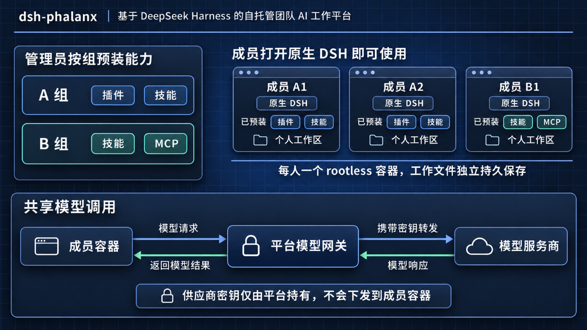

# dsh-phalanx

[简体中文](README.zh-CN.md)

## Self-host DSH for your team. Give every member their own workspace.

**Ready from the first sign-in, with keys kept on the platform.** An administrator configures shared models, plugins, skills and MCP services on one Linux host. Members open their browser and work in native DeepSeek Harness inside separate containers with persistent workspaces.

**[Try it online →](https://phalanx.htmlgo.to/)** · **[Self-host on Linux](#quick-installation)** · **[Architecture](docs/architecture.md)**



## Why dsh-phalanx

- **One dedicated rootless Podman container per member.** Each member runs DSH and a terminal in their own container, with isolated home and workspace directories. Administrators can set default or per-member CPU, memory and process limits, idle reclamation, and resident instances.
- **Unmodified upstream DSH.** Phalanx packages pinned upstream DSH (currently [`dsh-v0.2.2-rc.5`](runtime-versions.json)) and its runtime dependencies in a container image and integrates only through the official CLI, configuration and HTTP/WebSocket seams. Members use the native DSH interface and plugin ecosystem.
- **Centrally held keys beyond models.**
  - **Shared model gateway:** Supports Anthropic Messages, OpenAI Chat Completions and OpenAI Responses. Provider keys stay on the platform and are attached only when forwarding upstream.
  - **Isolated credentials for plugins, MCP and skills:** Plugin upstreams, remote or platform-run MCP services, and delegated skill commands keep real third-party credentials outside member containers. Members and agents use granted capabilities without reading the underlying keys.
- **Signed catalogs and shared runtime dependencies.** Plugin, skill and MCP catalogs share one Ed25519-signed index. Administrators can enforce group-managed resources, preinstall native plugins or publish entries to the Platform App Center. Shared dependencies (CLIs, Python libraries, document SDKs) are prepared once and mounted read-only.
- **Built for real operations.** Includes a single-command installer (interactive or unattended, with official and Mainland China download presets), built-in or external PostgreSQL, in-place upgrades with automatic rollback on failure, an independent `/recovery` page, browser account switching and usage records.

## Engineering and security design

If you plan to self-host, audit the boundaries or read the code, here is how the repository is built:

- **Minimal runtime footprint:** The control plane runs on Node.js and PostgreSQL with **6 production dependencies** (`cookie-es`, `http-proxy-3`, `pg`, `ws`, `yaml`, `yauzl`) — no heavy framework and no ORM black box.
- **Enforced layered architecture:** `src/` follows a 7-layer dependency table, with all DSH protocol facts isolated in `src/dsh/`. Automated lint gates enforce layer boundaries, per-file size limits and bilingual documentation parity. See the [architecture guide](docs/architecture.md).
- **Clear encryption and storage boundaries:** Platform secrets use AES-256-GCM envelope encryption with record- and field-scoped AAD, unlocked by a separate host master key. Durable user spaces, PostgreSQL state and rebuildable projections are kept in distinct layers.
- **Verified against real seams:** Fast fake-port unit tests sit alongside end-to-end acceptance suites covering real DSH, rootless Linux containers and cross-version upgrades.

## Try it online

Select **在线体验** (online demo) on the demo homepage and sign in to spin up a temporary site. A model API key with a small usage allowance is preconfigured so you can try native DSH chat and platform administration immediately.

- Each demo site lasts **1 hour**; the site and its data are deleted when the timer expires.
- Demo hosts have limited resources, so the first DSH start can be slower than on a self-hosted server.

**[Open the online demo →](https://phalanx.htmlgo.to/)**

## Quick installation

Use a **Debian-family amd64 host with sudo access** (Ubuntu 24.04 and 26.04 are verified). The installer sets up host packages, a dedicated rootless Podman service account, the bundled runtime and the matching DSH image (currently tracking [`dsh-v0.2.2-rc.5`](runtime-versions.json)) — no local Node.js toolchain or image build is required.

```sh
curl -fsSLo install.sh https://raw.githubusercontent.com/dake6767/dsh-phalanx/main/install.sh && sudo bash install.sh
```

The installer supports English and Simplified Chinese, official or Mainland China download sources, and `--non-interactive` setup. Open the initialization link printed at the end to:

1. Keep the built-in PostgreSQL or connect an external PostgreSQL server;
2. Create the first administrator account;
3. Configure a shared model provider and add a member account.

For host requirements, HTTPS reverse proxy setup and first sign-in details, see the [installation guide](docs/install.md).

## Documentation

| What you need | Guide |
| --- | --- |
| Install on a new host, configure HTTPS and open DSH as the first member | [Installation guide](docs/install.md) · [简体中文](docs/install.zh-CN.md) |
| Back up, upgrade in place, switch databases, move or recover a deployment | [Operations](docs/operations.md) · [简体中文](docs/operations.zh-CN.md) |
| Manage accounts, groups, shared models, platform features and catalogs | [Administrator guide](docs/admin-guide.md) · [简体中文](docs/admin-guide.zh-CN.md) |
| Configure plugin upstreams, native service bindings and MCP services | [Plugin and MCP access](docs/plugin-access.md) · [简体中文](docs/plugin-access.zh-CN.md) |
| Set up platform execution for skills and shared runtime dependencies | [Skill execution](docs/skill-execution.md) · [简体中文](docs/skill-execution.zh-CN.md) |
| Use DSH, Platform App Center, downloads and instance recovery | [Member guide](docs/member-guide.md) · [简体中文](docs/member-guide.zh-CN.md) |
| Layers, seam ownership, runtime guarantees and design tradeoffs | [Architecture diagram](docs/diagrams/overview-light.svg) · [Architecture guide](docs/architecture.md) |
| Local development, image builds, real DSH tests and the release process | [Contributing](CONTRIBUTING.md) |
| Changes and acceptance records for each release | [Releases](https://github.com/dake6767/dsh-phalanx/releases) |

## Community, license and trademarks

This is a community project, neither affiliated with nor endorsed by DeepSeek. Architecture discussions and reproducible issue reports are welcome. Maintenance is low-touch, with no support SLA or promised response time.

The code is licensed under [Apache-2.0](LICENSE). See [NOTICE](NOTICE) and the [trademark statement](TRADEMARKS.md). DSH and other external dependencies retain their own licenses and notices.
