# dsh-phalanx

[English](README.md)

dsh-phalanx 是面向小团队的多用户 DSH 自托管平台：在一台服务器上运行 DeepSeek Harness（DSH），让每位成员都有独立的用户空间。

团队不必为每个人重复部署 DSH、分发共享模型密钥。部署者安装平台，管理员创建账户、配置共享模型供应商，成员登录后就能在自己的空间里工作。

## 四项亮点

- **每人一个 rootless 容器。** 每位成员的 DSH 用户实例运行在独立容器中，home 和 workspace 分开持久保存，彼此不共享文件目录。
- **通过官方接缝集成 DSH。** 平台使用 DSH 官方 CLI、配置、插件及 HTTP/WebSocket 接口，不 fork、不修改 DSH 源码。
- **统一模型网关。** 管理员配置一次共享模型供应商，成员直接选择启用的模型。供应商密钥留在平台，不进入成员空间；成员仍可通过终端和自己的插件访问外部模型。
- **平台应用与自主安装。** 管理员维护插件库与技能库，为分组设置平台预装，也可发布可选应用供成员自行选择。插件默认安装为成员自行管理的原生副本，平台管控及共享凭据自选以只读方式加载；管理员可让上游凭据留在成员空间之外。成员仍可安装原生 DSH 插件、使用终端及非模型设置。

## 多用户 DSH 如何运行

一套部署包括宿主机上的平台服务和每位成员独立运行的 DSH 用户实例。平台安装包提供登录、管理界面和模型网关；配套镜像提供 DSH 及其运行工具。平台使用同一份镜像，为每位成员启动独立的 rootless Podman 容器。

<picture>
  <source media="(prefers-color-scheme: dark)" srcset="docs/diagrams/overview-dark.svg">
  
</picture>

成员访问 `/app/<spaceId>/` 时，请求先到平台服务。平台核对登录状态和用户空间归属，按需启动该成员的 DSH 用户实例，再转发 HTTP 和 WebSocket 请求。成员在浏览器中使用的是 DSH 原生界面。

共享模型请求从用户实例发往平台的模型网关。网关选择供应商，并在发往上游时注入密钥。成员可以使用管理员启用的模型，供应商密钥留在平台侧。

| 部分 | 包含什么 | 如何提供 |
| --- | --- | --- |
| 平台服务 | 登录、账户管理、管理界面、请求转发和模型网关 | 平台安装包，在宿主机上运行 |
| DSH 运行环境 | 构建后的 DSH 程序、原生 Web 界面、生产依赖和 Node.js | 随配套镜像提供 |
| 用户工具 | Corepack/pnpm、Git、curl、Python/pip、编译工具和 bubblewrap 沙箱工具 | 随配套镜像提供，供终端、插件和 DSH 工具使用 |
| 用户文件 | 每位成员自己的 home 和 workspace | 保存在宿主机的用户数据根，分别挂载到对应容器 |
| 平台集成 | 平台插件与技能、共享模型列表和配置 | 平台生成并只读挂载到容器，供应商密钥不随配置挂载 |

镜像按[构建配方](containers/dsh/Containerfile)，从固定摘要的 Node.js/Debian 基础镜像开始，拉取 [runtime-versions.json](runtime-versions.json) 指定的官方 DSH 提交，在构建阶段安装锁定依赖并编译，再将构建后的 DSH 目录和生产依赖复制到运行镜像。DSH 源码保持原样，集成通过官方 CLI、配置和插件完成。

镜像不包含账户、模型密钥或成员文件。PostgreSQL 保存平台事实与加密凭据，独立保护的主密钥负责解密。本机制品与生成的投影、成员持久文件分别存放；重建实例会保留成员文件并重新生成平台投影。五层存储及恢复要求见[存储与备份](docs/install.zh-CN.md#存储布局)。自行构建、导入镜像和验证容器运行的步骤见[贡献指南](CONTRIBUTING.md#build-the-dsh-instance-image)。

管理员在系统升级模块管理兼容的原地更新，查看阶段、诊断及平台自动恢复结果。
候选部署可以转为同号正式版。兼容要求、任务中断及成员文件的独立备份见
[升级与恢复指引](docs/install.zh-CN.md#recoverable-system-updates)。

分组授权不是安装白名单。每个账户只属于一个分组，平台应用与成员自装插件共存。对于支持修改服务地址、通过请求头认证的插件，平台可转发请求并注入凭据，成员无需取得真实 Key。配置、生命周期和边界见[分组与插件](docs/install.zh-CN.md#分组与插件)、[技能使用](docs/install.zh-CN.md#技能)及[插件与 MCP 接入](docs/plugin-access.zh-CN.md)。MCP 服务可接入远程地址、在平台隔离进程或成员容器中运行，通过分组授权和成员自选控制使用范围；平台凭据留在成员空间之外。

## 快速安装

准备一台 **Ubuntu 24.04 LTS、amd64 架构且有 sudo 权限**的主机，运行：

```sh
curl -fsSLo install.sh https://raw.githubusercontent.com/dake6767/dsh-phalanx/main/install.sh && sudo bash install.sh
```

安装器选择最新的已完成稳定版，准备主机依赖、平台服务及配套 DSH 镜像。无需预装开发用 Node.js/pnpm，也无需模型密钥即可安装。按提示确认访问地址和公网 IPv4 清单，打开输出的初始化链接创建首个管理员，再配置共享模型供应商。

HTTPS、域名和云安全组由部署者配置，详细步骤见安装说明。

## 文档导航

| 你想了解什么 | 文档 |
| --- | --- |
| 安装、存储、HTTPS、服务管理与恢复 | [中文安装说明](docs/install.zh-CN.md) · [English](docs/install.md) |
| 组建、授权、召唤和使用专家 | [专家指南](docs/experts.zh-CN.md) · [English](docs/experts.md) |
| 分层、接缝归属、运行时保证与设计取舍 | [架构文档（英文）](docs/architecture.md) |
| 本地开发、镜像构建、真实 DSH 测试与发布流程 | [贡献指南（英文）](CONTRIBUTING.md) |
| 每次发布的变化与验收记录 | [Releases](https://github.com/dake6767/dsh-phalanx/releases) |

## 社区、许可与商标

这是社区项目，与 DeepSeek 无隶属关系，也未获其背书。项目欢迎架构讨论和可复现的问题报告，采用 low-touch 维护，不承诺支持 SLA 或响应时间。

代码采用 [Apache-2.0](LICENSE)，另见 [NOTICE](NOTICE) 与[商标声明](TRADEMARKS.md)。DSH 及其他外部依赖保留各自的许可和声明。
