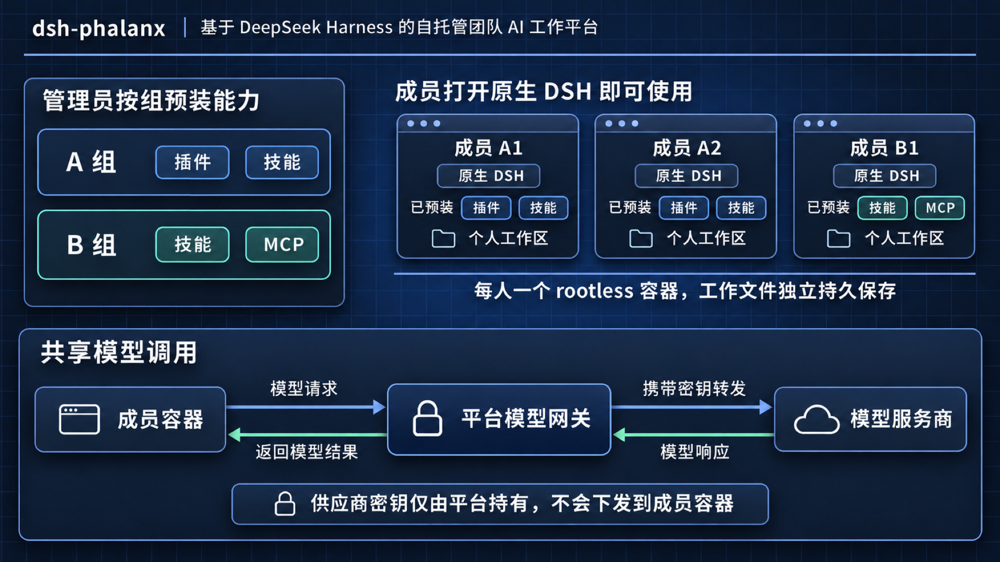

# dsh-phalanx

[English](README.md)

## 为团队自托管 DSH，每人一个独立工作空间。

**成员开箱即用。** 管理员统一配置共享模型和插件，成员打开浏览器就能使用原生 DeepSeek Harness。

[在 Linux 上自部署](#快速安装)



## 亮点

- **每人一个独立的 rootless Podman 容器。** 成员在自己的容器里运行 DSH、使用终端，个人目录和工作区与其他成员隔离。
- **DSH 源码零改动。** Phalanx 把原版 DSH 和运行依赖打包成镜像，通过官方 CLI、配置和 HTTP/WebSocket 接口接入平台。成员在浏览器里打开的就是 DSH 原生界面。
- **沿用 DSH 生态。** 成员默认可以自行安装原生插件，也能从平台应用中心选用插件、技能和 MCP 服务。管理员可以从插件广场挑选团队常用的插件，按组预装。
- **共享模型，密钥留在平台。** 成员在 DSH 里选择已启用的模型。供应商密钥由平台保管，只在网关向供应商转发请求时注入。
- **按组授权，使用可审计。** 管理员按组授权插件、技能和 MCP 服务，在「使用记录」里查看共享模型用量，也能按成员或分组追溯经过平台网关的工具调用。

## 快速安装

准备一台**有 sudo 权限的 Debian 系 amd64 主机**。Ubuntu 24.04 和 26.04 已验证。安装器会准备运行环境和配套 DSH 镜像。

```sh
curl -fsSLo install.sh https://raw.githubusercontent.com/dake6767/dsh-phalanx/main/install.sh && sudo bash install.sh
```

你也可以在体验站首页点「在线体验」，登录后创建临时站点。我们也预置了带少量体验额度的模型密钥，你可以流畅地体验原生 DSH 的对话。

**每个临时站点限时体验 1 小时。** 到期后，站点及其数据会一并删除。体验站性能有限，首次启动 DSH 会稍慢，自部署时通常会快不少。

**[打开在线体验站 →](https://phalanx.htmlgo.to/)**

打开安装器输出的初始化链接，创建首个管理员，再配置共享模型和成员账户。主机要求、HTTPS 配置和首次登录步骤见[安装说明](docs/install.zh-CN.md)。

## 文档导航

| 你想了解什么 | 文档 |
| --- | --- |
| 从空主机安装到成员首次打开 DSH | [安装说明](docs/install.zh-CN.md) · [English](docs/install.md) |
| 备份、升级、迁移与恢复 | [运维指南](docs/operations.zh-CN.md) · [English](docs/operations.md) |
| 管理账户、模型、平台功能与资源分发 | [管理员指南](docs/admin-guide.zh-CN.md) · [English](docs/admin-guide.md) |
| 使用 DSH、平台应用中心、文件与恢复功能 | [成员指南](docs/member-guide.zh-CN.md) · [English](docs/member-guide.md) |
| 分层、接缝归属、运行时保证与设计取舍 | [架构图](docs/diagrams/overview-light.svg) · [架构文档（英文）](docs/architecture.md) |
| 本地开发、镜像构建、真实 DSH 测试与发布流程 | [贡献指南（英文）](CONTRIBUTING.md) |
| 每次发布的变化与验收记录 | [Releases](https://github.com/dake6767/dsh-phalanx/releases) |

## 社区、许可与商标

这是社区项目，与 DeepSeek 无隶属关系，也未获其背书。项目欢迎架构讨论和可复现的问题报告，采用 low-touch 维护，不承诺支持 SLA 或响应时间。

代码采用 [Apache-2.0](LICENSE)，另见 [NOTICE](NOTICE) 与[商标声明](TRADEMARKS.md)。DSH 及其他外部依赖保留各自的许可和声明。
